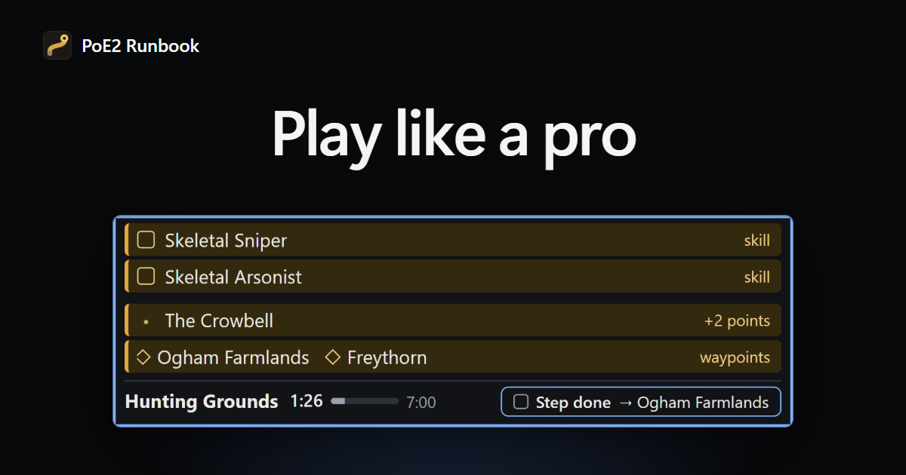

# PoE2 Runbook

**Play like a pro**

The plan's author has already spent the hundreds of hours of trial and error for you. Runbook leads you through the
plan: where to go, what to kill and what to pick up in every zone.

[poe2.labutin.gg](https://poe2.labutin.gg) · [Install](https://poe2.labutin.gg/install/) · [What Runbook reads](https://poe2.labutin.gg/safety/) · [Русский](README.ru.md)

- **You just play.** Enter a zone and Runbook already shows what to do there.
- **The red line stays.** Fall behind and the line turns red and stays until it's done.
- **Equip or drop.** Press F2 over an item to see whether it beats what you're wearing.
- **At the author's pace.** Every step and act has its time from the plan.
- **Know a better way?** Build your own plan. The campaign is already mapped: every zone, boss and reward.

**Every minute counts.** After the game, Review shows where the time went: step by step, in the zone, in town and off
the route. Compare with your previous hero and see where you got faster.

**For build authors.** You've put hundreds of hours into your build. Let them help others. In the catalogue your plan
stands under your name, with a link to you.
[How to add a plan to the catalogue](https://poe2.labutin.gg/about/#catalogue)

This is the first version, the program will keep developing, and any request is welcome: write what's missing or what
doesn't work in [Issues](https://github.com/LABUTIN-OU/poe2-runbook/issues/new/choose).

Runbook reads the game's log and settings, listens to three keys and sends the game one item copy per press of F2:
[What Runbook reads](https://poe2.labutin.gg/safety/).

## Run from source

Windows 10 or 11 and [Python 3.12](https://www.python.org/downloads/):

    python -m pip install pywebview
    python planner/desktop.py

It opens in its own window (WebView2 Runtime, part of Windows 11); data go to `%APPDATA%\PoE2 Runbook`.
`start.cmd` needs only Python: a page in the browser, data in the source folder, plan edits in `plans/`. Item and gem
pictures (art of Grinding Gear Games, 15 MB): `python -I catalog/fetch_icons.py`.

## Tests

    python -X utf8 -m unittest discover -s planner
    python -X utf8 -m unittest discover -s catalog
    python -X utf8 -m unittest discover -s release

A few skip without the raw game tables; `release` needs openssl (Git for Windows has it).

## Build the installer

With [Inno Setup 6](https://jrsoftware.org/isinfo.php) and the pictures downloaded:

    python -m venv packaging\.venv
    packaging\.venv\Scripts\python -m pip install pyinstaller pywebview
    packaging\.venv\Scripts\python packaging\build.py

The installer lands in `dist\`; official builds use PyInstaller 6.22.3 and pywebview 6.2.1.

## Site

`site/` is the published site (GitHub Pages); its pages are built from `work/site/src/` — edit there, then run
`python -X utf8 work/site/tools/build_site.py .` (`--check` only compares). More in `work/site/README.md`.

## Path of Exile 2

This product isn't affiliated with or endorsed by Grinding Gear Games in any way.

The game data here (`catalog/data/<version>`, `planner/static/*.json`, `treedata/ggg`) and the game's pictures belong
to Grinding Gear Games; the program's licence does not cover them. Raw game tables: `catalog/dat_pack.py`.

## Author and licence

© 2026 Sergei Labutin.

Designed and directed by the author; most of the code was written with an AI coding assistant (Claude by Anthropic).

Licensed under the GNU GPL version 3 with the author's additional terms (`LICENSE`, `NOTICE.md`); no warranty. A version
you share stays open, keeps "Based on PoE2 Runbook by Sergei Labutin — https://poe2.labutin.gg", says it is modified
and has its own name and icon. Official builds are published only at poe2.labutin.gg; the files themselves are stored
in the [releases of this repository](https://github.com/LABUTIN-OU/poe2-runbook/releases).

## Contributing and security

Contributions: under the agreement in [CONTRIBUTING.md](CONTRIBUTING.md). Vulnerabilities:
[report privately](https://github.com/LABUTIN-OU/poe2-runbook/security/advisories/new), see [SECURITY.md](SECURITY.md).
Contact: <games@labutin.gg>.
