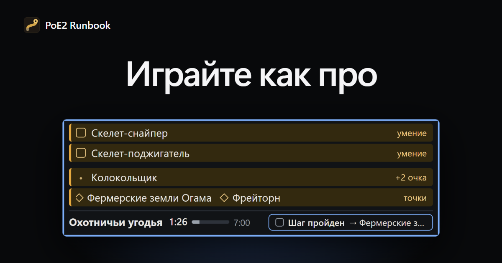

# PoE2 Runbook

**Играйте как про**

Сотни часов проб и ошибок за вас уже потратил автор плана. Runbook ведёт вас по нему: куда идти, кого убить и что
взять в каждой зоне.

[poe2.labutin.gg](https://poe2.labutin.gg/ru/) · [Установка](https://poe2.labutin.gg/ru/install/) · [Что программа читает](https://poe2.labutin.gg/ru/safety/) · [English](README.md)

- **Вы просто играете.** Вошли в зону — Runbook уже показывает, что в ней делать.
- **Красная строка не уйдёт.** Опоздали — строка краснеет и остаётся, пока не сделаете.
- **Надеть или выбросить.** F2 над предметом — и видно, лучше он надетого или хуже.
- **В темпе автора.** У каждого шага и акта — время из плана.
- **Знаете, как лучше?** Соберите свой план. Кампания уже размечена: каждая зона, босс и награда.

**Каждая минута на счету.** После игры «Разбор» показывает, куда ушло время: по шагам, в зоне, в городе и в стороне
от маршрута. Сравните с прошлым героем — и увидите, где стали быстрее.

**Авторам билдов.** Вы потратили на билд сотни часов. Пусть они помогут другим. В каталоге план будет стоять под вашим
именем и со ссылкой на вас. [Как добавить план в каталог](https://poe2.labutin.gg/ru/about/#catalogue)

Это первая версия, программа будет развиваться, и принимаются любые запросы: напишите в
[Issues](https://github.com/LABUTIN-OU/poe2-runbook/issues/new/choose), чего не хватает или что работает не так.

Программа читает лог и настройки игры, слушает три клавиши и посылает игре одну копию предмета на одно ваше нажатие
F2: [Что программа читает](https://poe2.labutin.gg/ru/safety/).

## Запуск из исходного кода

Windows 10 или 11 и [Python 3.12](https://www.python.org/downloads/):

    python -m pip install pywebview
    python planner/desktop.py

Программа откроется в своём окне (нужен WebView2 Runtime, он есть в Windows 11); данные — в `%APPDATA%\PoE2 Runbook`.
Для `start.cmd` нужен только Python: страница в браузере, данные в папке кода, правки плана в `plans/`. Картинки
предметов и камней (рисунки Grinding Gear Games, 15 МБ): `python -I catalog/fetch_icons.py`.

## Тесты

    python -X utf8 -m unittest discover -s planner
    python -X utf8 -m unittest discover -s catalog
    python -X utf8 -m unittest discover -s release

Несколько тестов без исходных таблиц игры пропускаются; тестам `release` нужен openssl (есть в Git для Windows).

## Сборка установщика

С [Inno Setup 6](https://jrsoftware.org/isinfo.php) и скачанными картинками:

    python -m venv packaging\.venv
    packaging\.venv\Scripts\python -m pip install pyinstaller pywebview
    packaging\.venv\Scripts\python packaging\build.py

Установщик появится в `dist\`; официальные сборки делаются на PyInstaller 6.22.3 и pywebview 6.2.1.

## Сайт

`site/` — опубликованный сайт (GitHub Pages); его страницы собираются из `work/site/src/` — правьте там и запускайте
`python -X utf8 work/site/tools/build_site.py .` (`--check` только сверяет). Подробнее — в `work/site/README.md`.

## Path of Exile 2

This product isn't affiliated with or endorsed by Grinding Gear Games in any way.

Данные игры здесь (`catalog/data/<версия>`, `planner/static/*.json`, `treedata/ggg`) и картинки игры принадлежат
Grinding Gear Games; лицензия программы на них не распространяется. Исходные таблицы игры: `catalog/dat_pack.py`.

## Автор и лицензия

© 2026 Sergei Labutin.

Замысел и все решения — автора; большую часть кода написал ИИ-помощник (Claude, Anthropic) под его руководством.

Лицензия — GNU GPL версии 3 с дополнительными условиями автора (`LICENSE`, `NOTICE.md`), без каких-либо гарантий.
Распространяемая версия открывает код под той же лицензией, сохраняет строку «Based on PoE2 Runbook by Sergei Labutin —
https://poe2.labutin.gg», говорит, что изменена, и носит своё название и значок. Юридическую силу имеет английский
текст. Официальные сборки публикуются только на poe2.labutin.gg; сами файлы лежат в
[выпусках этого репозитория](https://github.com/LABUTIN-OU/poe2-runbook/releases).

## Участие и безопасность

Правки — на условиях соглашения в [CONTRIBUTING.md](CONTRIBUTING.md). Уязвимости —
[сообщите закрыто](https://github.com/LABUTIN-OU/poe2-runbook/security/advisories/new), см. [SECURITY.md](SECURITY.md).
Почта для связи: <games@labutin.gg>.
